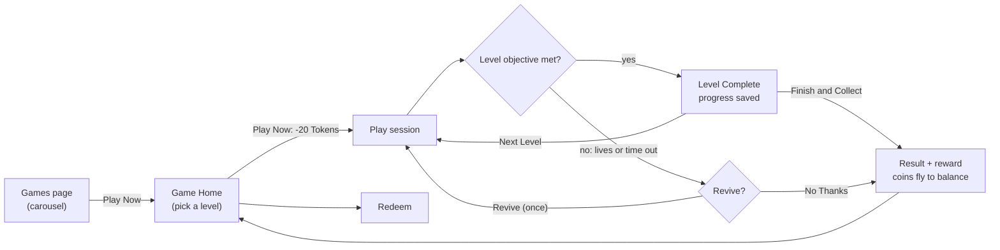
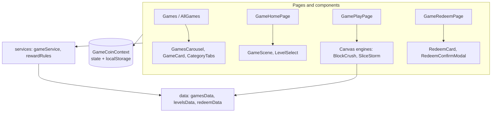

# VELoop Games

**A games section for the VELoop Rewards website: a compact auto-scrolling game carousel, two playable level-based games, and a shared Game Coin economy with a redeem center.**

| | |
|---|---|
| **Type** | Front-end single-page web application (React + Vite) |
| **Version** | `1.0.0` (from `package.json`) |
| **Status** | Working prototype built as an internship assessment task. It has no backend. |
| **Live demo** | `https://vr-games-banner.vercel.app/games` |
| **Repository** | `https://github.com/hrx0508/vr-games-banner` |

---

## Visual Preview

Everything below was captured from this project's own build. The screenshots live in [`docs/screenshots/`](docs/screenshots).

**Games section (phone, desktop) and browsing**

| Phone: two counter-moving rows | Desktop: single row | Browse All + categories |
|:---:|:---:|:---:|
|  |  |  |

**Game Home (one per game) and gameplay**

| Block Crush: Game Home | Slice Storm: Game Home | Block Crush: Level 3 | Slice Storm: Level 1 |
|:---:|:---:|:---:|:---:|
|  |  |  |  |

**Level Complete, Redeem, and the desktop Game Home**

| Level Complete | Redeem Game Coins | Game Home (desktop) |
|:---:|:---:|:---:|
|  |  |  |

---

## Project Overview

VELoop Games adds a games layer to a rewards website. Visitors see a row of game banners, open a game, pay a small **Token** entry fee, play through numbered **levels**, and earn **Game Coins**. Game Coins can then be converted into other in-app currencies (VEs, SVEs, Gems, Tokens, Spins) in the **Redeem** center.

- **Who it is for:** users of a rewards platform who would play short games to earn rewards, and the developers evaluating or extending this feature.
- **How it is used:** it is a self-contained React app with its own routes (`/games`, `/all-games`, `/games/:slug`, `/games/:slug/play`, `/redeem`). It is designed so the carousel and pages can be dropped into the host site.
- **What is included:** 13 game banners, 2 fully playable games (Block Crush, Slice Storm) with 10 levels each, and the full economy around them.
- **What is not included:** a backend, authentication, or real payouts. See [Limitations](#limitations-and-known-issues).

## Problem Statement

VELoop Rewards describes itself (in its page metadata) as a platform where users watch ads and complete tasks to earn real money. Ads and tasks are the earning methods the site advertises; a games section would add another, more interactive way to earn and a reason to return.

This project is a **prototype answer to one specific brief**: add a games section to the existing site, with a banner carousel, playable games, a token entry fee, rewards, and redemption. It is not backed by user research or usage data, and this README makes no claims about engagement or revenue impact.

## Solution and Approach

| Need | How the project addresses it |
|---|---|
| Show many games in little space | Compact image cards in a seamless, auto-scrolling carousel (two counter-moving rows on phones), plus a "Browse All Games" page with category filters |
| Make games feel worth returning to | 10 levels per game with real objectives, saved progress, stars, and Game Coins that scale with score and levels cleared |
| Keep one economy across all games | A single React Context holds Tokens, Game Coins, wallet, history, and level progress, so every page reads the same balance |
| Let players pay and play fairly | The entry fee is charged only after a play session is created, and a finished session can't be replayed for free |
| Let the front end be wired to a backend later | All data access goes through a small service layer (`gameService.js`, `rewardRules.js`) that is mocked today and documented as the swap-in point |
| Fit the host website | The header, colours, and sub-page header pattern follow the VELoop site screenshots supplied with the brief |

## Key Features

### Games banner section
- **Compact game cards** built from one data file (`gamesData.js`) by one reusable `GameCard`: full-bleed artwork, category, name, a **Play Now** button with a shimmer animation, and a token chip showing the entry fee.
- **Seamless auto-scrolling carousel** that pauses on hover, touch, wheel, keyboard focus, a hidden tab, or when off-screen. It supports touch swipe, mouse drag, and clickable dots. A small pause/play button is provided.
- **Two counter-moving rows on phones** (under 768 px): row 1 moves right to left and row 2 left to right. Tablets and desktops show one row.
- **Browse All Games** page with category filter chips (All, Puzzle, Arcade, Action, Strategy, Skill, Shooter, Word, Sports). The selected category is stored in the URL, so it can be linked and survives the Back button.
- **Card states:** default, hover, pressed, loading ("Starting…"), and insufficient Tokens (a `12/20` chip and an "Earn Tokens" button).
- **Loading and error states:** skeleton cards while games load, and an error screen with retry.

### Game Home
- A **light-theme page per game** with its own animated illustration, name, description, and level map.
- **Level map:** shows completed levels with stars, the next level highlighted, and later levels locked. The selected level's objective is shown. A "Continue where you left off" label appears when you have progress.
- **Play Now** shows the **Entry Fee (20 Tokens)** inside the button and your Token balance below it. If you can't afford it, a "Not Enough Tokens" dialog offers a path to Redeem.
- **How to Play** and **Rewards** dialogs, and a bottom **Home | Redeem** navigation.

### Playable games
- **Block Crush** (paddle and ball): clear every breakable block. Levels bring in 2- and 3-hit blocks and unbreakable steel blocks, and the ball gets faster while the paddle shrinks.
- **Slice Storm** (swipe to slice): each level has a different objective: slice N fruits, score N points against a timer, make N combos (three fruits in one swipe), or slice N watermelons. Targets, time limits, bomb frequency, launch density and speed all rise level by level.
- **Per-level lives, stars, and bonus points**, a **Level Complete** screen with **Next Level** or **Finish and Collect**, and one **free Revive** per run.
- **First-time guide** shown once per game.

### Economy and Redeem
- **One central balance** (Tokens and Game Coins) shared by every page.
- **Reward animation:** Game Coins fly from the result card to the balance chip and the number counts up.
- **Redeem center:** converts Game Coins to VEs, SVEs, Gems, Tokens, or Spins with a confirmation step, a success state, a "Not Enough Game Coins" state, and a history list.

### Accessibility and responsiveness
- Responsive from 320 px to desktop widths. All six routes were checked for horizontal overflow at 320, 375, 390, 412, 768 and 1440 px, with none found.
- Honors `prefers-reduced-motion` (auto-scroll and shimmer are disabled).
- Keyboard-operable controls, labelled buttons, `aria-pressed` filter chips, `inert`/`aria-hidden` on the duplicated carousel copies, and Escape-to-close dialogs.

## Innovation and Unique Value

This is a conventional React front end. The value is in how a few specific problems were handled:

- **Seamless carousel on a native scroller.** The list is rendered three times and the scroll position silently jumps by one set-width, so the loop never visibly rewinds. Because it uses a normal scroll container, touch, trackpad and wheel scrolling work without custom gesture code. See `src/hooks/useCarousel.js`.
- **One reusable carousel hook, two directions.** `useCarousel` accepts a `direction`, an `enabled` flag, and an external `paused` flag. That is how the second phone row moves the opposite way and still obeys the single pause button.
- **Level data is the single source of truth.** `levelsData.js` drives the game engines, the level map, and the objective text, so they cannot drift apart.
- **A paid session can't be replayed for free.** A session is created by `startSession()` and consumed by `finishSession()`. Opening a play URL without a valid session redirects to the Game Home.
- **Rewards are credited exactly once,** even if the player leaves while the coin animation is still running.
- **Rewards come from a service function** (`finishSession`), and the UI shows the value it returns, which is the shape a backend-confirmed reward would need.

## How It Works

### Player journey



### Code architecture



### What happens when a game is played
1. **Game Home:** pressing Play Now checks the Token balance, calls `startSession(slug)`, deducts the entry fee with `spendTokens`, and navigates to the play page with `{ sessionId, level }`.
2. **Play page:** `useGameSession` runs the phases `guide → playing → (levelup ↔ playing) → (revive) → result`. The engine receives `level`, `running`, and callbacks, and reports stats (score, lives, objective progress, time).
3. **Level cleared:** `completeLevel` writes the stars and unlocks the next level immediately, so progress is saved before the player chooses what to do next.
4. **Run ends:** `finishSession` returns the reward (`score ÷ points-per-coin + 3 per level cleared`, capped). The reward is credited once when the coin animation lands, and the player returns to the Game Home.

## Technology Stack

| Technology | Purpose | Where or how it is used |
|---|---|---|
| **React 18** | UI | All pages and components (`src/`) |
| **Vite 5** + `@vitejs/plugin-react` | Dev server and build | `vite.config.js`; `assetsInlineLimit: 0` keeps every AVIF a separate cacheable file |
| **React Router 6** | Client-side routing | `src/App.jsx` (5 routes plus redirects) |
| **CSS Modules** (built into Vite) | Scoped component styling | One `*.module.css` per component or page |
| **Framer Motion 11** | Animation | Modals, toasts, level-map ring, stars, coin flight, page entrances |
| **Lucide React** | Icons | Header, buttons, level map, HUD |
| **Canvas 2D API** (browser) | Game rendering | `src/games/BlockCrush/Game.jsx`, `src/games/SliceStorm/Game.jsx` |
| **Context + `useReducer`** (React) | Central state | `src/context/GameCoinContext.jsx` |
| **`localStorage`** (browser) | Persistence of balances, history, and level progress | Key `veloop-games-state-v1` |
| **AVIF images** | Small artwork files | `src/assets/games/` (13 banners, about 1.2 MB total) and `src/assets/ui/` |
| **Poppins** (Google Fonts) | Typeface | Loaded in `index.html`; system fonts are the fallback |
| **Bootstrap 5.3** | Imported global CSS | `src/main.jsx` imports `bootstrap.min.css`. **No Bootstrap classes are used in the JSX**; all styling is custom (see [Limitations](#limitations-and-known-issues)) |

There are no runtime services, databases, or third-party APIs. The only network request at runtime is the Google Fonts stylesheet.

## Architecture and Project Structure

```text
veloop-games/
├── index.html                  # entry HTML, Poppins font, mobile viewport
├── package.json
├── vite.config.js
├── vercel.json                 # SPA rewrite for Vercel
├── public/
│   ├── favicon.svg
│   └── _redirects              # SPA rewrite for Netlify
├── docs/screenshots/           # images used by this README
└── src/
    ├── main.jsx                # mounts <App/> in a BrowserRouter
    ├── App.jsx                 # providers and routes
    ├── pages/                  # Games, AllGames, GameHomePage, GamePlayPage, GameRedeemPage
    ├── components/
    │   ├── games/              # GameCard, GamesCarousel, CarouselDots, CategoryTabs, PlayNowButton,
    │   │                       # TokenCost, AppHeader, GameHeader, GameNavigation, GameScene, LevelSelect,
    │   │                       # LevelComplete, GameGuide, ReviveModal, GameOver, RewardFlight,
    │   │                       # RedeemCard, RedeemConfirmModal, GamesSkeleton, ErrorState, ...
    │   └── ui/                 # Modal, Toast
    ├── games/
    │   ├── BlockCrush/         # canvas engine + styles
    │   ├── SliceStorm/         # canvas engine + styles
    │   └── registry.js         # maps game.engine -> component
    ├── context/GameCoinContext.jsx   # Tokens, Game Coins, wallet, history, level progress
    ├── hooks/                  # useCarousel, useGameSession, usePlayGame, useCountUp,
    │                           # useMediaQuery, useReducedMotion, useBodyBg
    ├── services/               # gameService.js (mock API), rewardRules.js
    ├── data/                   # gamesData.js, levelsData.js, redeemData.js, themes.js
    ├── assets/                 # games/ (13 AVIF banners), ui/ (token, coin, gem, ve, sve, spin)
    └── styles/                 # variables.css (design tokens), global.css
```

| Area | Responsibility |
|---|---|
| `pages/` | Route-level screens; compose components and hooks |
| `components/games/` | Reusable game-section UI |
| `games/*` | Self-contained canvas engines that share one prop contract: `level`, `levelKey`, `running`, `reviveKey`, `onStats`, `onLevelComplete`, `onGameOver` |
| `context/GameCoinContext.jsx` | The only place balances and progress are written |
| `hooks/useGameSession.js` | Orchestrates one paid run and saves level progress |
| `services/` | The seam where a real backend would plug in |
| `data/` | Games list, level definitions, redeem rates, per-game themes |

**Adding a game:** add an entry to `gamesData.js` (set `playable` and `engine`), add its levels to `levelsData.js`, a theme to `themes.js`, and register the engine in `games/registry.js`.

## Getting Started

### Prerequisites
- **Node.js 18 or newer** (Vite 5 requires it). The project was developed and verified on Node 22 with npm 10.
- **npm**.
- An internet connection is only needed for the Google Fonts stylesheet. Without it, system fonts are used.

### Installation
```bash
git clone <your-repository-url>
cd veloop-games
npm install
```

### Configuration
**No environment variables or `.env` file are required.** The project contains no secrets and no API keys.

### Run in development
```bash
npm run dev
```
Vite serves the app (by default at `http://localhost:5173`). Open `/games`.

### Build and preview
```bash
npm run build      # production build to dist/
npm run preview    # serve the production build locally
```

### Available scripts
| Script | Command | Purpose |
|---|---|---|
| `dev` | `vite` | Development server with hot reload |
| `build` | `vite build` | Production build |
| `preview` | `vite preview` | Serve the built `dist/` |

The project defines no test or lint scripts.

## Usage and Examples

### Routes
| Route | Screen |
|---|---|
| `/` | Redirects to `/games` |
| `/games` | Games carousel with a "Browse All Games" button |
| `/all-games` | All games, grouped by category, with filter chips (`/all-games?category=Puzzle` is linkable) |
| `/games/block-crush`, `/games/slice-storm` | Game Home (only the two playable games have one) |
| `/games/:slug/play` | The game (requires a session created from the Game Home) |
| `/redeem` | Game Coin redeem center |

The other 11 banners show a "coming soon" message when Play Now is pressed.

### A typical session
1. Open `/games` and press **Play Now** on **Block Crush** or **Slice Storm**.
2. On the Game Home, pick a level (Level 1 on a first visit) and press **Play Now**. 20 Tokens are deducted.
3. Read the guide (first time only), then play. Block Crush: drag or use the arrow keys. Slice Storm: swipe across the fruit.
4. Clear the objective to pass the level and unlock the next one, or lose all lives and choose **Revive** or **No Thanks**.
5. Collect your Game Coins, then open **Redeem** to convert them.

### Starting balances and rules (prototype values)
| Item | Value | Defined in |
|---|---|---|
| Starting Tokens / Game Coins | 150 / 20 | `GameCoinContext.jsx` |
| Entry fee | 20 Tokens | `ENTRY_COST` in `gamesData.js` |
| Block Crush reward | 1 coin per 30 points + 3 per level cleared, max 40 per run | `gamesData.js` |
| Slice Storm reward | 1 coin per 25 points + 3 per level cleared, max 40 per run | `gamesData.js` |

| Redeem | Costs | Gives |
|---|---|---|
| VEs | 100 Game Coins | 10 |
| SVEs | 100 Game Coins | 5 |
| Gems | 50 Game Coins | 5 |
| Tokens | 25 Game Coins | 20 |
| Spins | 60 Game Coins | 3 |

These conversion rates are dummy values in `redeemData.js`.

### Testing helpers
- **Demo tools:** open the settings (gear) button in the header to set Tokens to 150 or 12 (to see the insufficient-Tokens state) or to reset all saved data.
- **Error screen:** add `?simulateError` to a Game Home URL, then press Play Now.
- **Reset everything:** use "Reset" in Demo tools, or delete the `veloop-games-state-v1` key from `localStorage`.

## API Documentation

**The project exposes no HTTP API and makes no backend calls.** Data access goes through a mock service layer in `src/services/`, which is the intended swap-in point for a real backend.

| Function | Purpose | Input | Returns |
|---|---|---|---|
| `fetchGames()` | Load the games list (mock of `GET /games`) | none | `Promise<Game[]>` after a simulated 750 ms delay |
| `startSession(slug)` | Create a play session (mock of `POST /games/:slug/sessions`) | game slug | `Promise<{ sessionId, slug, cost }>`; rejects if the URL contains `?simulateError` |
| `finishSession({ slug, sessionId, score, levelsCleared })` | Close a session and get the reward | session and result data | `Promise<{ sessionId, score, reward, confirmed: true }>` |
| `isSessionActive(id)` / `abandonSession(id)` | Check or discard an unfinished session | session id | `boolean` |
| `calculateReward(slug, score, levelsCleared)` (`rewardRules.js`) | Reward formula used by `finishSession` | slug, score, levels | `number` of Game Coins |

Note that the mock `startSession` does not charge Tokens. The Token deduction happens in the UI (`spendTokens` in the Game Home) and would move server-side in a real backend.

## Security and Privacy

This is a front-end prototype, so it has **no real security model**:

- **No authentication or authorization.** There are no user accounts.
- **All state is client-side** in the browser's `localStorage` (`veloop-games-state-v1`): balances, redeem history, best scores, and level progress. Anyone can edit it in the browser tools, so it must not be trusted as a source of truth.
- **Rewards are calculated in the browser** (`rewardRules.js`). A production system must validate the session, score, levels and completion on a server, calculate the reward there, and update balances there.
- **The play-session guard is in memory** (`gameService.js`). It stops accidental free replays, but it is not a security control.
- **No secrets, keys, or personal data** are stored in the repository or collected by the app.
- The only third-party request is to Google Fonts.

## Challenges and Technical Decisions

These are design trade-offs visible in the code:

- **Infinite carousel without a rewind.** Three copies of the list plus a silent jump by one set-width keep the loop seamless. The jump is deferred until the scroll settles, so manual swiping is not interrupted. Duplicate copies are `inert` so keyboard users don't tab through them.
- **Two rows, one pause control.** The second phone row is a second hook instance that is only enabled below 768 px and is paused by the first row's state, so there is a single, predictable pause button.
- **Engines are isolated from React state.** The canvas games run in a `requestAnimationFrame` loop on refs and report to React only when stats change, which avoids re-rendering on every frame. Both engines share one prop contract, so the play page and session hook don't care which game is running.
- **Difficulty lives in data.** Block Crush layouts and Slice Storm objectives/speeds are plain objects in `levelsData.js`. Slice Storm's difficulty comes from density, bombs, lives and time limits, because a missed fruit costs a life.
- **Progress is saved at the moment of success,** not at the end of the run, so quitting or refreshing never loses a cleared level.
- **Session validity is checked once when the play page opens.** Re-checking it on every render redirected players home the moment the finished session was consumed and the balance changed.
- **Cached images:** `GameCard` detects images that are already loaded when it mounts, because an `onLoad` that fired earlier would otherwise leave the image invisible.
- **Emoji on canvas:** colour emoji inherit the canvas fill alpha, so the fill is reset before drawing fruit.
- **Two currencies on purpose.** Tokens (entry) and Game Coins (rewards) are separate, so earning rewards never directly funds free play.

## Limitations and Known Issues

- **Prototype only:** no backend, accounts, or real payouts. Mock services simulate latency, and conversion rates are dummy values.
- **Only 2 of the 13 games are playable.** The other 11 are banners that show a "coming soon" message.
- **Progress is per browser.** It lives in `localStorage`, so it is lost if browser data is cleared and does not sync across devices.
- **Reward logic runs on the client** and is not tamper-proof (see [Security and Privacy](#security-and-privacy)).
- **Bootstrap is imported but unused.** `bootstrap.min.css` is about 232 kB of the 282 kB CSS bundle even though no Bootstrap classes appear in the JSX. It could be removed to cut the CSS payload substantially.
- **Slice Storm requires a pointer** (finger or mouse). There is no keyboard alternative for slicing.
- **Slice Storm difficulty is tuned from automated bot runs,** not from human playtesting. Levels 7, 9 and 10 beat the bot quickly, but how they feel to people is unverified.
- **Short-phone layout:** on a phone around 844 px tall, the Game Home's Play Now button sits close to the fixed bottom navigation and needs a small scroll to be fully visible.
- **Tested in Chromium only** (desktop browser with phone-sized windows and touch emulation). Safari/iOS and Firefox were not tested, and there was no testing on physical devices.
- **No sound,** and no automated tests (see [Testing](#testing-and-quality-assurance)).
- **Dev-only debug hook:** in development builds, the engines expose `window.__game` for testing. It is stripped from production builds (`import.meta.env.DEV`).

## Future Improvements

- **Backend integration:** server-side sessions, Token charging, score validation, reward calculation, and synced progress. This is the most important gap.
- **Automated tests:** unit tests for `rewardRules`, the context reducer, and level data; component tests for `GameCard`; and end-to-end tests for the play, level-save, and redeem journeys (currently done by hand).
- **Remove unused Bootstrap** (or adopt its utilities) to shrink the CSS bundle.
- **More playable games** for the remaining 11 banners, reusing the engine contract and `levelsData.js` pattern.
- **Human playtesting and tuning** of Slice Storm's level table, and a keyboard-accessible alternative mode.
- **Leaderboards and daily challenges** once a backend exists.
- **Sound and haptics** with a mute setting.
- **Linting and formatting** (ESLint, Prettier) and a CI check that runs the build and tests.

## Testing and Quality Assurance

**There is no automated test suite, linter, or formatter in this repository.** Quality checks so far were manual or ad hoc:

- `npm run build` completes successfully. At the time of writing the output is `index.js` about 372 kB (122 kB gzip) and `index.css` about 282 kB (42 kB gzip).
- **Browser verification in Chromium** using throwaway Playwright scripts that were *not* added to this repository. They covered: responsive layouts at 320 to 1440 px with an overflow check; carousel direction and pause behavior on phone profiles; the full play, level-clear, "Next Level", game-over, revive, and reward flow for both games; saving, leaving, refreshing and reopening at the right level; insufficient Tokens and insufficient Game Coins states; redeem confirm and success; and category filtering and deep links.
- **Bot play-throughs** confirmed Block Crush Levels 1 and 4 are winnable through real physics, and checked Slice Storm's objective logic and difficulty ramp.

No coverage figures exist because no coverage tooling is configured.

## Deployment

The app is a static single-page build, so any static host works.

| Setting | Value |
|---|---|
| Build command | `npm run build` |
| Output directory | `dist` |
| Environment variables | none |
| SPA routing | `vercel.json` (Vercel) and `public/_redirects` (Netlify) rewrite every path to `index.html`, so deep links such as `/games/block-crush` work |

The project has not been deployed. Because routes are client-side, a host without a rewrite rule would return 404 on a page refresh at any route other than `/`.

## Contributing

This is a small prototype, so the process is simple:

1. Fork the repository and create a branch (`git checkout -b feature/short-description`).
2. Make your change and check it with `npm run build` and by running the app (`npm run dev`).
3. Open a pull request describing what changed and why, with screenshots for UI changes.

There are no formal contribution guidelines yet.

## Acknowledgements

- **Brief and artwork:** the task brief, the 13 game banner images, the reward icons (Game Coin, token, VE, SVE, gems, spin voucher), and the VELoop website screenshots were supplied with the assessment and remain the property of their owners.
- **Open-source libraries:** [React](https://react.dev), [Vite](https://vitejs.dev), [React Router](https://reactrouter.com), [Framer Motion](https://www.framer.com/motion/), [Lucide](https://lucide.dev), and [Bootstrap](https://getbootstrap.com).
- **Typeface:** [Poppins](https://fonts.google.com/specimen/Poppins) via Google Fonts.
- Block Crush and Slice Storm are original implementations of generic game mechanics written for this project. Fruit and bomb graphics in Slice Storm use the system's emoji font.
- **Author:** `<your name>`

## License

**No license has been specified** for this project (there is no `LICENSE` file). Until one is added, all rights are reserved by the author, and others do not have permission to reuse the code. The bundled artwork and brand assets belong to their respective owners.